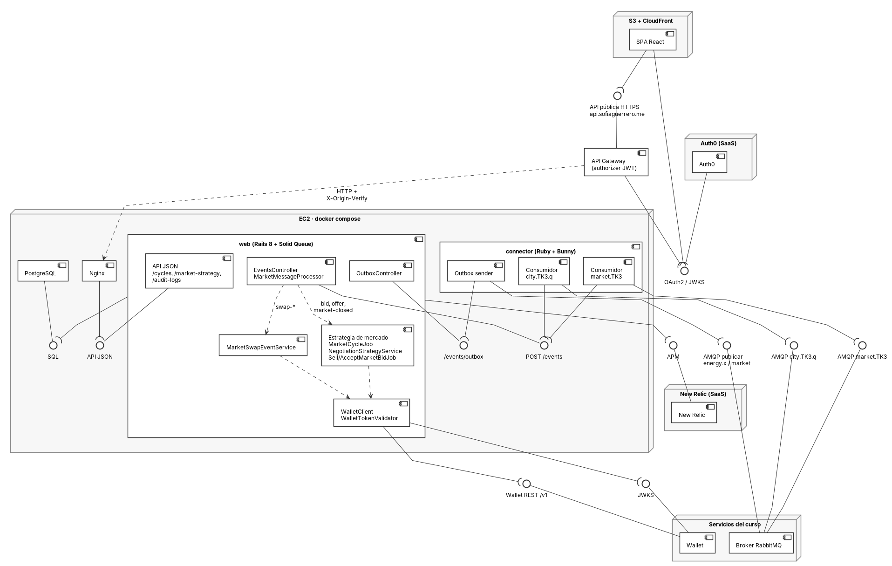

# Diagrama de componentes · E2

Fuente editable: [`uml/componentes-e2.puml`](uml/componentes-e2.puml) (PlantUML). Versión vectorial: [`uml/componentes-e2.svg`](uml/componentes-e2.svg).

**Notación.** Cada interfaz se dibuja como un círculo (*lollipop*) unido al componente que la **provee**. Un semicírculo (*socket*) indica que un componente **requiere** esa interfaz. Cuando un componente provee y otro requiere la misma interfaz, se ve el ensamble *ball-and-socket*. Las flechas punteadas son dependencias internas de `web`.

## Interfaces

| Interfaz | La provee | La requiere | Qué viaja |
| --- | --- | --- | --- |
| AMQP `city.TK3.q` | Broker del curso | connector (consumidor city) | Mensajes de la central, bids y respuestas de otras ciudades, eventos de la wallet (`swap-*`) |
| AMQP `market.TK3` | Broker del curso | connector (consumidor market) | Ofertas de todas las ciudades y `market-closed` |
| AMQP publicar (`energy.x`, `market`) | Broker del curso | connector (outbox sender) | ACK/NACK, bids, `bid-accepted`/`bid-rejected`, ofertas (`market.offer.TK3`), `negotiation-report` |
| `POST /events` | web (EventsController) | connector (ambos consumidores) | Cada mensaje validado, reenviado por HTTP por la red interna de Docker |
| `/events/outbox` | web (OutboxController) | connector (outbox sender) | Mensajes pendientes de publicar y el resultado de cada publicación |
| Wallet REST `/v1` | Wallet del curso | web (WalletClient) | `POST /swaps`, `accept`, `cancel`, `GET /balance`, `/statement` |
| JWKS de la wallet | Wallet del curso | web (WalletTokenValidator) | Llaves públicas para verificar el `swapToken` (ES256) |
| SQL | PostgreSQL | web | Ciclos, ofertas, bids, estrategias, intenciones de swap, outbox y auditoría |
| API JSON | web (API JSON) | Nginx | Rutas para la SPA: `/cycles`, `/market-strategy`, `/audit-logs`, ... |
| API pública HTTPS | API Gateway | SPA | `https://api.sofiaguerrero.me`, con JWT de Auth0 |
| OAuth2 / JWKS | Auth0 | SPA y API Gateway | Login de la SPA y validación del JWT en el authorizer |
| APM | New Relic | web | Trazas de la API, de los jobs y de las llamadas HTTP a la wallet |

## Explicación

**Las dos colas.** El connector es la única pieza conectada al broker (ADR1, re-examinado en ADR7). Tiene un consumidor por cola, cada uno en su propio canal, con confirmación manual y prefetch 1. El de `city.TK3.q` valida el envelope y el `user_id`, y responde ACK o NACK al remitente, sea la central u otra ciudad. El de `market.TK3` guarda el feed, que no se responde. Como cada cola tiene su canal, una ráfaga de ofertas no retrasa un `status-statement`. Un mensaje se confirma al broker solo después de que `POST /events` lo guardó.

**El cliente de la wallet.** `WalletClient` es el único componente que habla con la wallet. Antes de cada escritura guarda la `Idempotency-Key` en la base y la reutiliza en cada reintento ante 502, 503, 504, 429 o timeout (ADR5). El resultado llega después como evento `swap-*` por `city.TK3.q`, y `MarketSwapEventService` lo aplica una sola vez, apareándolo por `idpk`. `WalletTokenValidator` verifica el `swapToken` contra el JWKS antes de aceptar un swap.

**Dónde vive la estrategia.** La política de mercado está en la tabla `market_strategies` (ADR4) y se edita por `/market-strategy`. `MarketCycleJob` toma la estrategia activa al inicio de cada ciclo y la registra en el ciclo. `NegotiationStrategyService` arma la oferta y elige el mejor bid por precio efectivo (precio más transporte). `SellMarketBidJob` acepta los bids en serie por oferta con un lock en la base (ADR6), y `AcceptMarketBidJob` acepta los swaps como comprador. El mecanismo no cambia cuando cambia la política: un cambio aplica en el ciclo siguiente, sin redeploy.

**Salida.** Todo lo que el nodo publica se guarda primero en el outbox, y el outbox sender del connector lo publica. Si el broker se cae, los mensajes esperan en la base y no se pierden.

**Acceso desde el front.** La SPA, servida desde S3 y CloudFront, llama a la API pública. API Gateway valida el JWT de Auth0 y reenvía a Nginx en la EC2 con el header `X-Origin-Verify`, y Nginx la pasa a la API JSON de `web`.
